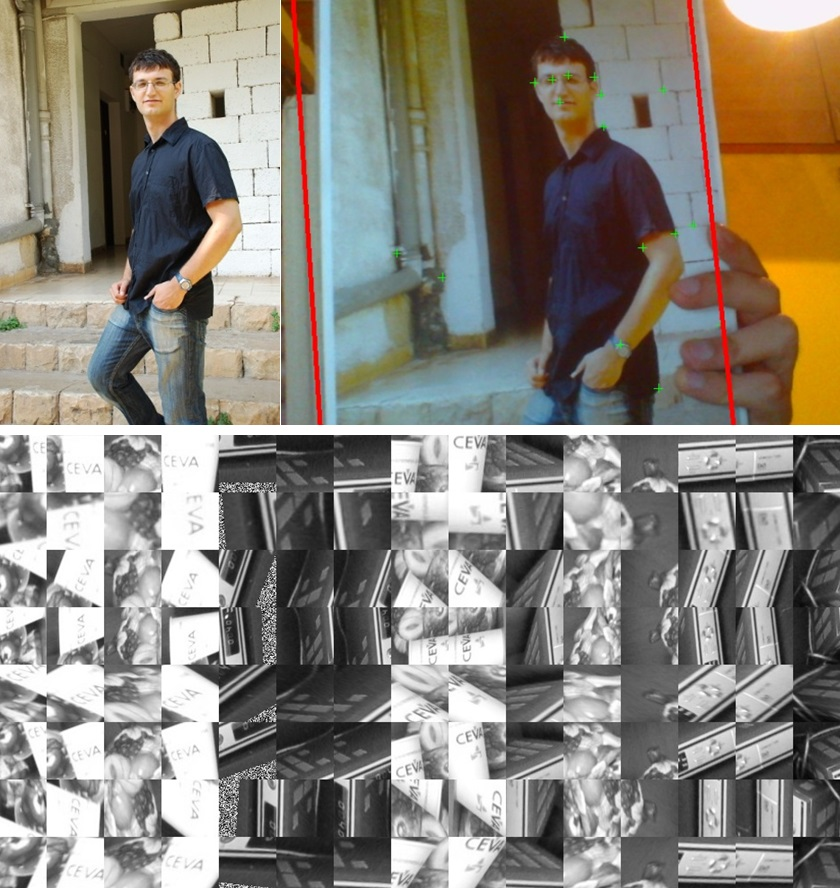

# Marker tracking

  

Real-time marker detection and pose estimation using FAST features and a decision-tree classifier.

Students: Alex Kemarsky.

Supervision: Aaron Wetzler.

## Status

**Partial original desktop source recovered. Build and run untested.** `source/` preserves 83 unchanged text files from the final tracking/training handoff, including student C#/C++ source, original project files and the original usage instructions. The intended iPod port was not completed; this is not an iOS application.

## Original code

The recovered desktop source is in [`source/`](source/): the tracking solution in [`source/tracking-2008/`](source/tracking-2008/), the training solution in [`source/training-2010/`](source/training-2010/), and the student's original [`README - usage.txt`](<source/README - usage.txt>). Several referenced dependencies are intentionally absent; see below.

## Running

The student's handoff specifies **Visual Studio 2008 for tracking** and **Visual Studio 2010 for training**. The preserved entrypoints are `source/tracking-2008/WebCamCSharp.sln` and `source/training-2010/Tracking.sln`. They use Windows Forms/C#, a native C++ TrackingDLL and MFC; the archive has a mixture of .NET 3.5/4.0 project configurations. Original `Program.cs` opens MainForm for tracking and Form1 for training. No historical compiler was invoked during recovery.

See `source/README - usage.txt` for original menu instructions: select a marker and training output directory, train, then load the trained marker for camera tracking. The program expects `C:\Temp`; tracking loads `Tree0.dat`. The handoff reports that VS2008 camera capture reached 640x480 and that VS2010 capture/VS2008 training had problems. These are historical observations, not new test results.

### Missing Dependencies

Touchless WebCamLib/WebCamWrapper and EasyWebCam camera components are not redistributed. Bundled FAST detector code and the RANSAC files crediting Peter Kovesi are withheld pending separate provenance/license review. These exclusions leave referenced projects, headers and functions missing; the solutions are partial and cannot build as provided. `detectFast.cpp` is a MATLAB MEX helper and references `mex.h`; no MATLAB release was established.

The handoff's Test 2008/Test 2010 packages contain disguised DLL/EXE files with `.aa`/`.bb` extensions. They were neither imported nor executed. VCS state, user-specific project files, compiled artifacts, trained trees, images and unreviewed reports/presentations are excluded. No blanket license is inferred from the source handoff.

## Links

- [Project entry on Aaron Wetzler's website](https://twerdster.github.io/#marker-tracking)

## Attribution and Updates

Original student credits and file notices are preserved. No blanket license has been added; omitted camera/algorithm dependencies require their own terms. Original authors can open an issue to contribute updates or request corrections or removal of their material.

Figure provenance: `assets/project-preview.jpg` is the original student-project figure from the archived project page on Aaron Wetzler's website, copied without modification.

