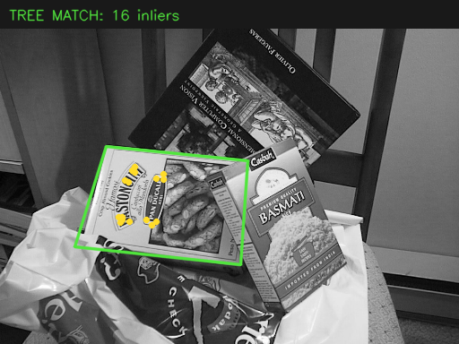
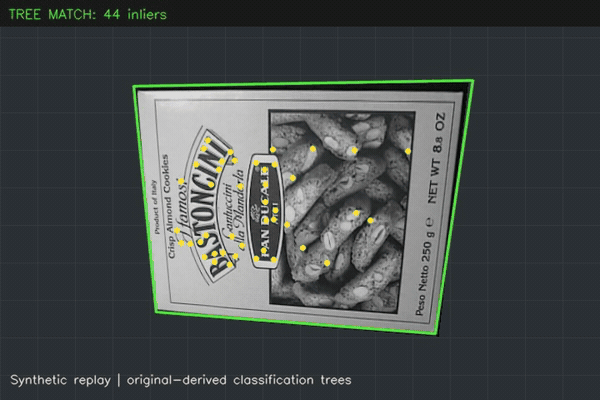

# Marker Tracking — updated implementation

## Updated and ported for modern hardware

The recovered classification-tree core now builds as a C++17 tracker, tested on macOS 15 arm64 and Ubuntu 22.04 x86_64. This port fixes tree-training and model-reader defects, replaces missing camera/FAST/RANSAC dependencies with OpenCV, and adds marker training, saved-image/video replay, and a local camera viewer. The original Windows source is preserved separately; the feature-input pipeline and frontend are updated work. The repository’s historical README describes that recovered Windows snapshot.



*Actual updated output on OpenCV's `box_in_scene.png`, trained from `box.png`. Green marks the estimated marker boundary; yellow points are RANSAC inliers. This is a new run on a real photograph, not the historical project screenshot.*



*New synthetic perspective, partial-occlusion, absence and reacquisition replay. The source marker is a real photograph; its motion is generated. The boundary and points come from the tracker, not the known replay transform. [MP4](assets/replay.mp4).*

## Build and run

Requirements: C++17 compiler, CMake 3.16 or newer, and OpenCV with `core`, `imgproc`, `imgcodecs`, `features2d`, `calib3d`, `videoio`, and `highgui`; Python 3.9 or newer for the optional demo downloader. CMake accepts OpenCV 4.5 or newer, but only 4.12.0 was tested. No GPU or Windows/.NET installation is required.

A conventional Ubuntu/Debian setup is `build-essential cmake libopencv-dev python3`; that package-based setup was not tested. Both recorded macOS and Linux runs used task-local OpenCV 4.12.0 builds. On macOS, an installed CMake/OpenCV development package can be used if its runtime dependencies load correctly. From the repository root:

```sh
cmake -S updated -B updated/build -DCMAKE_BUILD_TYPE=Release
cmake --build updated/build -j4
(cd updated/build && ctest --output-on-failure)
python3 updated/tools/run_demo.py --exe updated/build/marker_tracker --output /tmp/marker-demo
python3 updated/tests/check_results.py /tmp/marker-demo
```

If CTest fails to load an OpenCV shared library, see [the recorded macOS dependency workaround](BUILD.md#macos-dependency-mismatch-observed) before continuing.

Choose a new `--output` directory on each run. The demo downloads three small, pinned OpenCV sample photographs, verifies their hashes, trains the forest, checks a real photograph and an unrelated image, generates a labeled synthetic replay, and processes that replay through the video decoder. Results include PNG overlays, JSON measurements, an unannotated input AVI and annotated output AVIs. The recorded Mac Release run trained 32 new trees for 95 marker points in 7.669 seconds; the [stdout record](validation/macos-release/stdout.txt) and [validation JSON](VALIDATION.json) retain the measured timing.

For your own marker:

```sh
updated/build/marker_tracker train marker.jpg /tmp/my-marker-model
updated/build/marker_tracker image /tmp/my-marker-model photo.jpg /tmp/result.png /tmp/result.json
updated/build/marker_tracker video /tmp/my-marker-model input.mp4 /tmp/tracked.avi /tmp/tracked.json
updated/build/marker_tracker camera /tmp/my-marker-model 0
```

Use a textured, approximately planar marker with many distinct, well-separated features. Training rejects markers with fewer than eight selected features; eight is the rejection floor, not a recommendation for reliable tracking. Camera mode opens the selected local camera and a native viewer; press Escape to close. Camera access depends on OS permissions and the device. Saved-video input needs an OpenCV video backend that can decode that format; output is Motion JPEG AVI. The tested replay uses AVI and does not require FFmpeg. See [BUILD.md](BUILD.md) for an isolated macOS dependency build and sanitizer commands.

## How it works

Candidate keypoints are detected at several scales with OpenCV's FAST-based ORB detector. The code uses its keypoint orientation, **not ORB descriptors or descriptor matching**, to extract oriented 64×64 patches. The adapted student classification trees learn transformed patches and vote for marker-point classes. Candidate correspondences are filtered by vote strength, winner/runner-up separation and unique marker class; OpenCV RANSAC estimates a planar homography from the remaining points.

The port uses 32 newly trained original-style ternary trees (the historical configuration used 100), with the ±10 pixel-difference rules, depth-eight stopping rule and 1,024-quantized leaf histograms. It changes the feature preprocessing, augmentation, correspondence filtering, geometric fitting and application frontend. [PORTING.md](PORTING.md) identifies the retained source, repairs and replacements in detail.

## Recorded checks

| Run | Real-photo inliers / matches | Inlier fit RMSE | Synthetic visible / absent frames | Known-corner RMSE | Decoded video |
| --- | --- | --- | --- | --- | --- |
| macOS Release | 16 / 39 | 1.546 pixels | 48 / 48 detected; 0 / 12 false positives | 5.920 pixels | 60 frames |
| macOS ASan/UBSan | 16 / 39 | 1.546 pixels | 48 / 48 detected; 0 / 12 false positives | 5.920 pixels | 60 frames |
| Linux Release | 13 / 33 | 1.075 pixels | 48 / 48 detected; 0 / 12 false positives | 7.443 pixels | 60 frames |

All three runs rejected the unrelated photograph. Independently trained forests differ across platforms because the retained training core uses the C library’s random generator; geometric fitting also depends on the numerical implementation. No speed comparison is implied.

The [validation record](VALIDATION.json) and [raw results](validation/) contain the actual environments, outputs and scope. They cover compilation, tree regression cases, model save/load, a real photograph, an unrelated-image rejection, the synthetic sequence and video decoding. One CTest entry groups the tree regression checks; that count is not the number of independent tracking benchmarks. The synthetic sequence has known corners for independent corner-error measurement. Real-photo inlier error measures fit to the accepted correspondences, not external ground-truth pose accuracy.

The real pair and synthetic replay were development fixtures used while selecting preprocessing and correspondence thresholds. They are demonstrations and regressions, not held-out accuracy or speed benchmarks. Runtime values describe the recorded process and hardware only. See the JSON records for the measured values and any platform differences.

## Limitations

This is an adapted classifier with a new surrounding application, not an unchanged build of the recovered Windows software. It does not restore the old C# UI, original feature-stability selector or iPod application. Old `Tree0.dat` model directories are not directly compatible with the new model metadata.

Tracking assumes a textured planar target. Heavy blur, large perspective changes, feature-poor surfaces, occlusion and repeated patterns can produce rejection or a wrong correspondence set. There is no general detection-rate claim, calibrated 3D pose, temporal tracking model or mobile-platform validation. A live camera path is included but the recorded proof uses saved data; no live-camera session is claimed unless separately recorded.

Original code and credits remain in [`../source/`](../source/). Author permission does not establish a blanket repository license or rights to the withheld dependencies. This port does not include those dependencies. OpenCV and sample-data provenance are described in [PORTING.md](PORTING.md).
